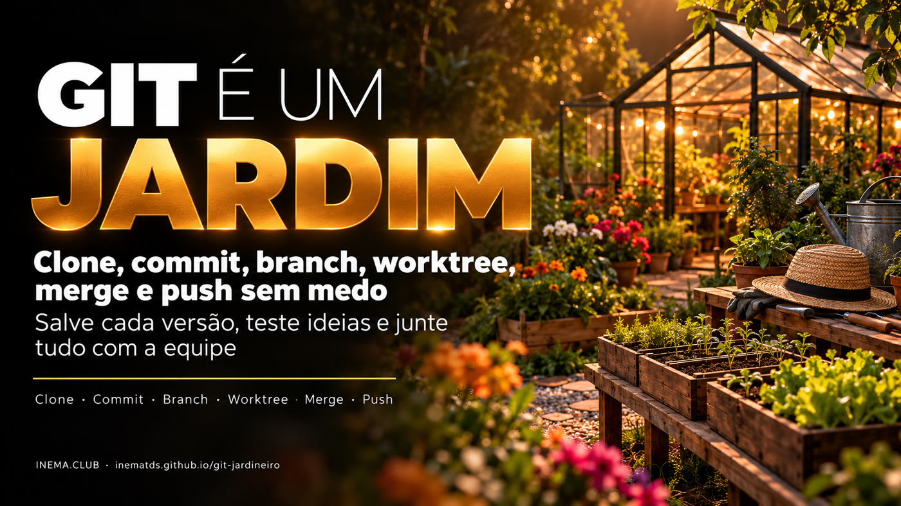

# Git êƒÂ© um jardim

  
  
<strong>Arckhé AI</strong>

 ê‚· ê°Å¸â€¡Âºê°Å¸â€¡Â¸ [English](README.en.md) ê‚· ê°Å¸â€¡Âªê°Å¸â€¡Â¸ [EspaêƒÂ±ol](README.es.md)**

## O que êƒÂ©

Este êƒÂ© um guia grêƒÂ¡tis que explica o Git usando a histêƒÂ³ria de um jardineiro. O Git êƒÂ© a ferramenta que guarda cada versêƒÂ£o de um projeto, como fotos de um jardim tiradas ao longo do tempo. Serve para quem programa, para quem trabalha com agentes de IA e para quem sêƒÂ³ quer parar de perder arquivos. Aqui vocêƒÂª aprende seis comandos (clone, commit, branch, worktree, merge e push), cada um com um desenho, uma explicaêƒÂ§êƒÂ£o simples e os comandos prontos para copiar. Para praticar, basta ter o Git instalado.

## ê°Å¸â€œâ€“ Guia de uso

Guia completo (landing + 6 pêƒÂ¡ginas explicativas): **https://linnoff88-dev.github.io/

## ê°Å¸Å½Â¬ VêƒÂ­deos

- Explicativo 16:9 (3 min): https://github.com/linnoff88-dev/git-jardineiro/releases/download/video-v1.0.0/git-jardineiro-16x9.mp4
- Reel 9:16 (31 s): https://github.com/linnoff88-dev/git-jardineiro/releases/download/video-v1.0.0/git-jardineiro-reel.mp4
- Players no guia: https://linnoff88-dev.github.io/

O roteiro e o roteiro visual estêƒÂ£o em `video/`.

## Os 6 passos

1. **Clone** ê¢â‚¬â€ Trazer o jardim pra casa: O clone copia o projeto e toda a histêƒÂ³ria dele para o seu computador. (https://linnoff88-dev.github.io/
2. **Commit** ê¢â‚¬â€ Tirar a foto do jardim: Edite, escolha o que entra e tire a foto. O commit salva no seu computador. (https://linnoff88-dev.github.io/
3. **Branch** ê¢â‚¬â€ Testar uma ideia nova: Branch êƒÂ© uma etiqueta que anda junto com os seus commits novos. (https://linnoff88-dev.github.io/
4. **Worktree** ê¢â‚¬â€ Dois canteiros ao mesmo tempo: Worktree êƒÂ© outra pasta do mesmo projeto, aberta em outra branch. (https://linnoff88-dev.github.io/
5. **Merge** ê¢â‚¬â€ Juntar as mudanêƒÂ§as: Merge junta duas histêƒÂ³rias num commit novo. (https://linnoff88-dev.github.io/
6. **Push** ê¢â‚¬â€ Compartilhar com a equipe: Push leva os seus commits para o remoto. Agora a equipe pode pegar. (https://linnoff88-dev.github.io/

| | |
|---|---|
| `git clone <url> jardim` | trazer o projeto e a histêƒÂ³ria para o seu computador |
| `git status` | ver o que mudou e o que estêƒÂ¡ na bandeja |
| `git add .` | pêƒÂ´r as mudanêƒÂ§as na bandeja (êƒÂ¡rea de preparo) |
| `git commit -m "frase"` | tirar a foto: salvar a versêƒÂ£o no seu computador |
| `git switch -c flores` | criar a etiqueta flores e trabalhar nela |
| `git worktree add ../jardim-main main` | abrir outra pasta, em outra branch |
| `git merge flores` | juntar a branch flores na branch atual |
| `git push origin main` | levar as suas fotos para a estufa |
| `git fetch` | baixar a histêƒÂ³ria nova da estufa, sem juntar |
| `git pull` | baixar e jêƒÂ¡ juntar na sua branch |

## Para editar o guia

O texto mora em `src/<idioma>.json`; o HTML sai de `python3 src/build.py`.

Projetos e cursos gratuitos: https://ARCKHê‰ AI

---

  
  
<strong>Arckhé AI</strong>

